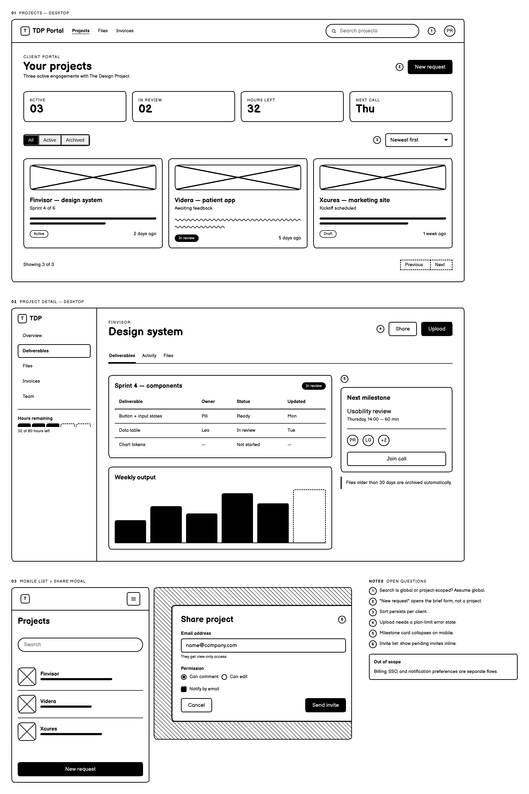

# TDP Wireframe Framework

Low-fidelity UI wireframes drawn in code: **Balsamiq Sans**, **black ink on white
paper**, rendered to PNG. No grey, no tint, no colour — structure, flow, and priority
only.

The framework is an agent skill. It ships its own design system, component vocabulary,
worked example, and two guard rails: a monochrome linter and a renderer that proves the
export carries no colour.

## What's inside

```
.agents/skills/create-wireframe/
├── SKILL.md                        the workflow an agent follows
├── assets/
│   ├── wireframe.css               the whole design system + embedded Balsamiq Sans
│   ├── template.html               starter board
│   ├── example-project-portal.html worked example (dashboard, detail, mobile, modal)
│   └── example-project-portal.png  its render — the quality bar
├── references/
│   ├── monochrome.md               how to build hierarchy with two values
│   ├── components.md               component markup, icons, states, annotations
│   └── review-checklist.md         pre-handover review
└── scripts/
    ├── render.sh                   HTML → trimmed PNG (inlines the sheet, checks chroma)
    └── lint-mono.sh                fails on any colour, opacity, shadow or remote asset
```

## Examples

| Dashboard, detail, mobile, modal | Notes panel |
|---|---|
|  | see the same file |

## Use it

With an agent in this repo, just ask for a wireframe — the skill is discovered from
`.agents/skills/`. To run it by hand:

```bash
S=.agents/skills/create-wireframe
cp $S/assets/template.html wireframes/my-flow.html

$S/scripts/lint-mono.sh wireframes/my-flow.html
$S/scripts/render.sh   wireframes/my-flow.html --width 1500 --inline
```

`render.sh` inlines the stylesheet and fonts, so `my-flow.standalone.html` opens
anywhere and `my-flow.png` is the thing you actually show people.

Requirements: `chromium` (or Chrome), `python3`, and ImageMagick (`magick`) for the
trim step. Everything renders offline.

## The rules

1. **Two values.** `#000` and `#fff`. The linter fails the build otherwise.
2. **Balsamiq Sans** for every glyph. It is embedded in `wireframe.css` (latin subset,
   woff2, SIL OFL 1.1 — © The Balsamiq Sans Project Authors).
3. **Offline.** No remote fonts, images, or scripts in the artefact.
4. **Images are crosses.** Never stock photography, never screenshots.
5. **No lorem ipsum.** Real domain words, or an honest placeholder.
6. **One loud element per screen.** A second solid-black button is a design bug.
7. **Caption and annotate every screen.** Numbered pins plus a notes panel; the board
   should be readable out loud.
8. **States count.** Empty, loading, error, permission-denied, long content: draw them
   or declare them out of scope.

Hierarchy without grey comes from four levers only: stroke weight, fill style
(solid / hatched / dashed / empty), type size and weight, and space. See
`references/monochrome.md`.

## Hosted boards

Every push deploys to Vercel through its Git integration: `master` to production
(https://tdp-wireframes.vercel.app), other branches to preview URLs.
`scripts/build-site.mjs` collects each `wireframes/<project>/<board>.html` (plus its PNG
and the shared `wireframe.css`) into `dist/` and writes an index, so a new board is
online after the next push. Build locally with `node scripts/build-site.mjs`.

To shortlist boards, add `wireframes/<project>/site.json` with
`{"shortlist": ["<board>"], "why": "<one sentence>", "title": "<list heading>"}`.
Shortlisted boards sit side by side at the top of the index and the rest are listed
as explorations. Use `"chosen"` instead of `"shortlist"` once one wins.

### Feedback on the hosted boards (CRRT)

Reviewers can pin comments on any hosted page with [CRRT](https://github.com/thedesignproject/CRRT).
Put the project's public key in `site.config.json`:

```json
{ "crrt": { "projectId": "<public project key>" } }
```

The build then adds the widget to every page in `dist/` (React and the widget load from
a CDN through an import map). Board sources, PNGs and standalone files are not touched,
so they stay offline and monochrome. Without the file, no widget is added.

## Design checks (Impeccable)

[Impeccable](https://impeccable.style) (Apache-2.0) is installed per project for Claude
Code (`.claude/`) and Codex (`.agents/skills/impeccable`, `.codex/hooks.json`). Its hook
scans every HTML file an agent edits and reports anti-patterns before the agent calls
the work done. In Codex, approve the project hook once via `/hooks`.

- The engine binary is not committed (`scripts/bin/` is ignored); the launcher downloads
  the pinned version into `~/.impeccable/` on first run.
- Ignores live in `.impeccable/config.json`, each with a reason. The detector cannot see
  `wireframe.css` (it is inlined at render time), so type-scale and padding findings on
  board sources are false positives; check the PNG and add a scoped ignore.
- Update: `npx impeccable update`, then re-commit.

## Adding a component

Add it to `assets/wireframe.css`, built only from `--ink`, `--paper`, `--stroke*` and
the spacing scale, then run `scripts/lint-mono.sh assets/wireframe.css`. Never patch a
screen file with local styling — the sheet is the design system.

## Collaborators

Repo lives under the TDP org (private). Wireframes produced with it belong in each
project's `wireframes/` directory, one file per flow.
